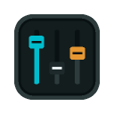
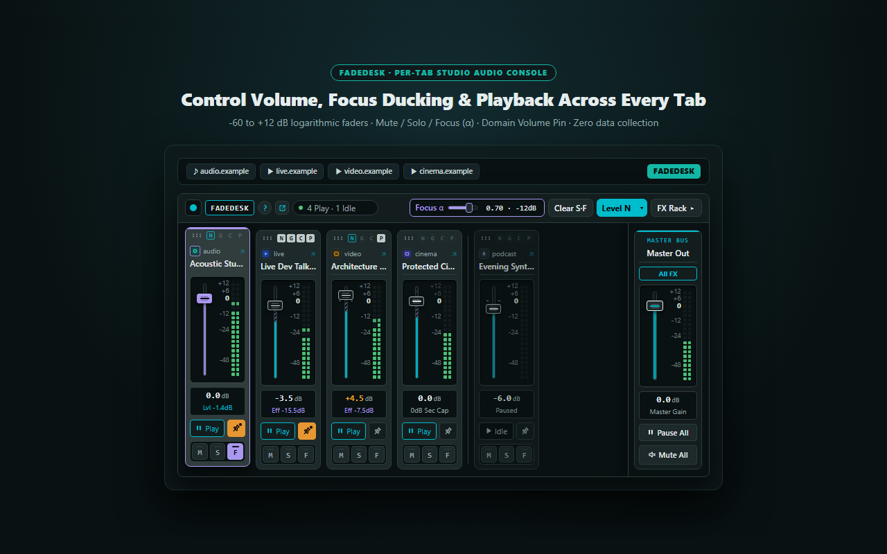
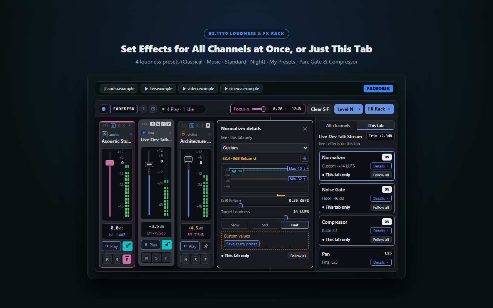
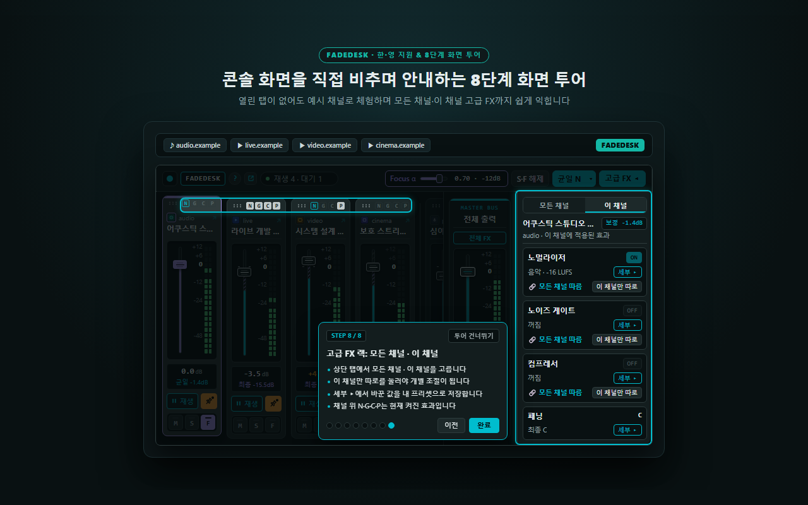
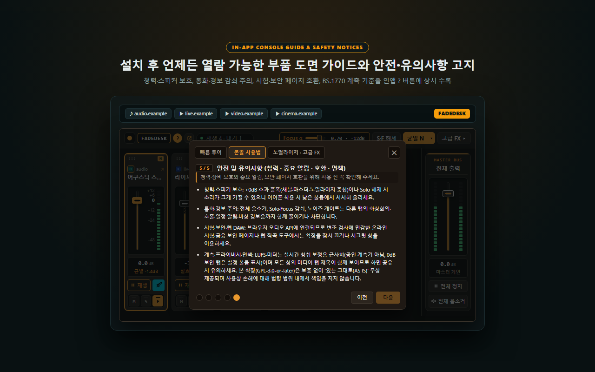

<div align="center">



# Fadedesk

**Every browser tab on its own studio fader.**

A studio-style per-tab audio mixer console for Chrome (Manifest V3) that brings playback, logarithmic `dB` faders (`-60` to `+12 dB`), Focus ducking, Solo, stereo pan, and `BS.1770` loudness leveling across all windows and background tabs into one desk.<br/>
Zero `tabCapture` banners. Zero network requests. 100% local.

[한국어](README.md) · [**English**](README.en.md) · [**Download Latest Release (`v1.2.4` ZIP)**](https://github.com/Argoneon1810/Fadedesk/releases/latest) · [Chrome Web Store](https://chromewebstore.google.com/detail/fadedesk/dfklknhlpfjhdijdaadgbliolpkkhhpi) · [Changelog](CHANGELOG.md) · [Privacy Policy](PRIVACY.md) · [Report an Issue](https://github.com/Argoneon1810/Fadedesk/issues)

</div>

---



## Why Fadedesk?

- **Keep lectures or calls clear over background music** — Press **`F` (Focus)** on your main tab and every other media tab gently ducks down by your chosen `Focus α` amount without muting completely.
- **Stop riding the volume keys between loud and quiet videos** — Toggle **`Level N ▾`** for real-time `ITU-R BS.1770-4` gated loudness leveling that lifts quiet speech, tames sudden peaks, and freezes gain during musical pauses so drum hits never explode.
- **Find and control noisy background tabs in one glance** — Media tabs across every Chrome window gather as channel strips. Play or pause remotely, drag strips to organize, or click a strip header (`↗`) to jump straight to that tab.
- **No "Sharing this tab" bar or fullscreen glitches** — Fadedesk hooks media elements and Web Audio directly instead of capturing tab streams via `chrome.tabCapture`, so Chrome never shows a blue sharing indicator or blocks fullscreen video.

---

## Installation

### 1. Direct Install from GitHub Releases (No Node.js Needed)

You can install the exact official release package right away without building from source:

1. Go to [GitHub Releases](https://github.com/Argoneon1810/Fadedesk/releases/latest), download **`fadedesk-1.2.4.zip`** ([Direct Download](https://github.com/Argoneon1810/Fadedesk/releases/download/v1.2.4/fadedesk-1.2.4.zip)), and extract it into a permanent folder (for example, `Documents/Fadedesk`).
2. Open `chrome://extensions` in Chrome and turn on **Developer mode** in the top-right corner.
3. Click **Load unpacked** in the top-left corner and select the extracted folder (the folder directly containing `manifest.json`).
4. Pin **Fadedesk** from Chrome's puzzle-piece toolbar menu. Already-open media tabs connect immediately without reloading.

### 2. Chrome Web Store

- [Fadedesk on the Chrome Web Store](https://chromewebstore.google.com/detail/fadedesk/dfklknhlpfjhdijdaadgbliolpkkhhpi)

<details>
<summary><strong>3. Build from Source (For Developers)</strong></summary>

Requires `Node.js 18+` (`20+` recommended).

```bash
git clone https://github.com/Argoneon1810/Fadedesk.git
cd Fadedesk
npm install
npm run build
```

Then open `chrome://extensions`, enable **Developer mode**, click **Load unpacked**, and select **`dist/unpacked`** (not the repository root).

</details>

---

## Console Walkthrough

### 1. Per-Tab `dB` Faders, Drag Zones & Domain Pin

- **Jump-Safe Knob Dragging (`-60 dB` to `+12 dB`)**: Faders move only when you grab the fader cap, preventing accidental track clicks from blasting volume. Scroll with the mouse wheel (`±1.5 dB`, or `Shift + Wheel` for `±0.5 dB` fine steps), or double-click any cap/readout to snap back to `0.0 dB`.
- **Direct `dB` Typing**: Click the digital readout beneath any fader to type an exact value like `-12.5` and press `Enter`.
- **Playing ↔ Paused Drag Zones & Tab Jump (`↗`)**: Drag a strip's top handle (`⠿`) to reorder channels, or drop it across the divider to pause or resume playback on the spot. Click the site header (`↗`) to bring that browser window and tab to the front.
- **Domain Default Pin (`📌`)**: Save a preferred startup volume per website. Pinning a domain sets the initial level for future tabs while keeping multiple open tabs on the same site completely independent.

### 2. Listening Modes — `Mute` · `Solo` · `Focus α`

| Switch | Behavior |
| --- | --- |
| **`M` (Mute)** | Silences that tab alone; click again to restore its previous fader level. |
| **`S` (Solo)** | Isolates the selected tab (`Shift+Click` for multi-Solo) and mutes all others. Closing the last `Solo` tab restores other tabs over a smooth `0.3s` ramp instead of an abrupt jump. |
| **`F` (Focus)** | Keeps this tab at full volume and smoothly turns the other tabs down by the top **`Focus α`** amount (slider or direct `dB` input). |

### 3. BS.1770 Loudness Presets (`Level N ▾`) & FX Rack (`All channels` · `This tab`)



The top **`Level N ▾`** split button runs a real-time `ITU-R BS.1770-4` loudness engine with `EBU Tech 3341` time windows to even out loudness across tabs (on by default with the **Music** preset for new installs).

- **Active band & return speed**: The normalizer only listens to sound inside the active band (for example `-32` to `-10 LUFS`). Outside it—very soft passages or explosive peaks—it stops correcting and glides back to the original level (`0.0 dB`) at the set return speed.
- **`-10 LU` relative gate**: Holds gain steady during quiet intros and reverb tails so the next beat never blasts.

| Preset | Target · Window | Max Boost | Best For |
| --- | --- | --- | --- |
| **Classical (Wide)** | `-16 LUFS` · `15s` wide | `+4 dB` | Wide-range music—returns to the original level on very soft solos and loud tuttis |
| **Music (Dynamic · Default)** | `-16 LUFS` · `9s` slow | `+6 dB` | Matching loudness between songs while keeping each song's dynamics |
| **Standard (Video)** | `-16 LUFS` · `3s` balanced | `+7.5 dB` | Switching between videos, streams, and lectures |
| **Night (Even)** | `-18 LUFS` · `0.4s` fast | `+9 dB` | Late-night listening—tames sudden loud effects, keeps soft dialogue clear |

Open **`FX Rack ▸`** on the right (or **`All FX`** on the Master Bus) and pick what you edit with the **`[All channels | This tab]`** tabs at the top. The target being edited (a channel strip, or the Master Bus for all channels) is raised, and the **`N` · `G` · `C` · `P`** chips on each strip show which effects are on.

- **`🔗 Follows all` and `Set separately`**: Normalizer, Noise Gate, and Compressor cards follow the all-channel settings and stay locked until you press **`Set separately`** for that tab; **`Follow all`** links it back.
- **`Details ▸` panel & My Presets**: **`Details ▸`** opens a side panel for the preset, active band (live spectrum `↕` / bar `↔`, draggable), return speed, and target loudness. Save tuned normalizer values with **`Save as my preset`** (up to 20, rename and delete supported) and pick them on other tabs or from **`Level N ▾`**.
- **Stereo Pan & Global Balance**: Place simultaneous streams left and right (`L100 – C – R100`). **Global Balance** in the all-channel settings shifts the whole mix while keeping each tab's relative position.
- **Noise Gate (`-65` to `-30 dB`)**: Mutes mic hiss and room noise below the threshold.
- **Dynamic Compressor (`2:1` / `4:1` / `8:1`)**: Tames sharp transients ahead of a `-1.0 dBFS` safety peak limiter.

### 4. Pop-Out Window (`↗`), 4 Studio Themes & 8-Step Screen Tour

| 8-Step Screen Tour | Interactive Schematic & Safety Guide |
| :---: | :---: |
|  |  |

- **Standalone Pop-Out Window (`↗`)**: Detach the mixer into a resizable desktop window (auto-clamped above `520×420` with remembered size) for a second monitor.
- **4 Studio Themes & a Dedicated Focus Color**: Switch among 4 palettes in Dark, Light, or System appearance. Focused strips use their own theme color, and the part of a fader you can't actually hear is hatched in a color that tells you why (Mute = red, silenced by `Solo` = Solo color, turned down by `Focus` = Focus color).
- **Screen Tour & Interactive Schematic (`?`)**: An 8-step tour highlights the real console—including the FX Rack—with short step-by-step cards (2 demo strips appear when no media tabs are open), plus an interactive parts diagram. UI switches automatically between **English** and **Korean**.

---

## Keyboard Shortcuts

Global shortcuts can be customized anytime at `chrome://extensions/shortcuts`.

| Scope | Windows / Linux | macOS | Action |
| --- | --- | --- | --- |
| Global | `Alt + Shift + M` | `Control + Shift + M` | Open Fadedesk console |
| Global | `Alt + Shift + 0` | `Control + Shift + 0` | Toggle Master Mute |
| Global | `Alt + Shift + F` | `Control + Shift + F` | Cycle `Focus` across active media tabs |
| In Console | `←` / `→` | `←` / `→` | Select previous / next channel strip |
| In Console | `↑` / `↓` (`Shift` fine) | `↑` / `↓` (`Shift` fine) | Adjust strip gain by `±1.5 dB` (`±0.5 dB`) |
| In Console | `0` / `Space` / `Enter` | `0` / `Space` / `Enter` | Reset `0.0 dB` / Play·Pause / Jump to tab |
| In Console | `M` / `S` / `F` / `P` | `M` / `S` / `F` / `P` | Toggle Mute / Solo / Focus / Domain Pin |

---

## Good to Know & Audio Safety

- **DRM & Cross-Origin Fallback (`0 dB` Cap)**: Encrypted streams (DRM/EME such as Netflix) and strict cross-origin media cannot be routed through Web Audio nodes without silencing audio. Fadedesk detects these automatically and falls back to native browser volume control (`-60` to `0 dB`) so playback never breaks.
- **Local Media Files (`file://`)**: To control local audio/video files opened in Chrome, enable **Allow access to file URLs** on Fadedesk's `chrome://extensions` details page.
- **Hearing & Speaker Protection**: Boosting above `0 dB` (especially stacking channel, master, and normalizer gain) or clearing `Solo` can raise loudness sharply. Start at a low volume when wearing headphones.
- **Calls, Alerts & Sensitive Pages**: Master Mute, `Solo`, `Focus`, and `Noise Gate` also turn down or silence web calls, meetings, calendar reminders, and emergency alerts in other tabs. Because Fadedesk hooks browser audio APIs, pause the extension or use Incognito during proctored online exams, strict banking security checks, or Web DAW production.
- **Metering & Screen Sharing**: `LUFS` and VU meters are real-time listening estimates, not certified broadcast compliance instruments. Media tab titles from all open Chrome windows appear together in the console—check before sharing your screen.

---

## Privacy & Permissions

Fadedesk **collects nothing and transmits nothing off your device.** Extension pages enforce `connect-src 'none'`, blocking outbound network requests at the browser policy level. Full details are in [PRIVACY.md](PRIVACY.md).

| Permission | Why It Is Needed |
| --- | --- |
| `tabs` | Lists open audible/media tabs with their title, domain label, and favicon, jumps to a tab when you click its strip header (`↗`), and matches hostnames against locally pinned default volumes. |
| `storage` | Saves console settings, themes, pop-out window size, My Presets, and domain pins in `chrome.storage.local`, and per-tab fader and FX states in `chrome.storage.session`—all strictly inside the browser. |
| `scripting` | Attaches the local audio controller to media tabs that were already open before Fadedesk was installed or updated—no tab reload required. |
| `<all_urls>` | HTML5 `<video>`, `<audio>`, and Web Audio can play on any website, so broad host access is required to apply real-time gain, pan, gate, compression, and loudness leveling wherever you listen. |

---

## Development & Verification

Written in zero-dependency runtime TypeScript (`src/`) + Web Audio API. [scripts/build.mjs](scripts/build.mjs) packages an explicit 17-file runtime whitelist into `dist/unpacked/` and `dist/fadedesk-<version>.zip`, with seamless audio-graph **Hot-Swap** across extension reloads.

```bash
npm test             # Full suite: typecheck + 43 unit/DOM/hot-swap tests + build + 26 headless Chrome ko/en UI audits
npm run typecheck    # TypeScript static analysis (tsc --noEmit)
npm run test:unit    # Audio math, state store, DOM hook, and hot-swap tests
npm run build        # Bundle dist/unpacked and dist/fadedesk-<version>.zip
npm run test:ui      # Headless Chrome layout overflow & interaction audit (Korean + English)
```

---

## Documentation & License

- **License**: [GNU General Public License v3.0 or later (`GPL-3.0-or-later`)](LICENSE) — provided free `"AS IS"` without warranty of any kind.
- **Third-Party Notices**: [THIRD_PARTY_NOTICES.md](THIRD_PARTY_NOTICES.md) (`0` third-party runtime dependencies shipped in the extension bundle)
- **Privacy Policy**: [PRIVACY.md](PRIVACY.md)
- **Changelog**: [CHANGELOG.md](CHANGELOG.md)
