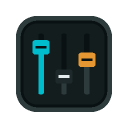
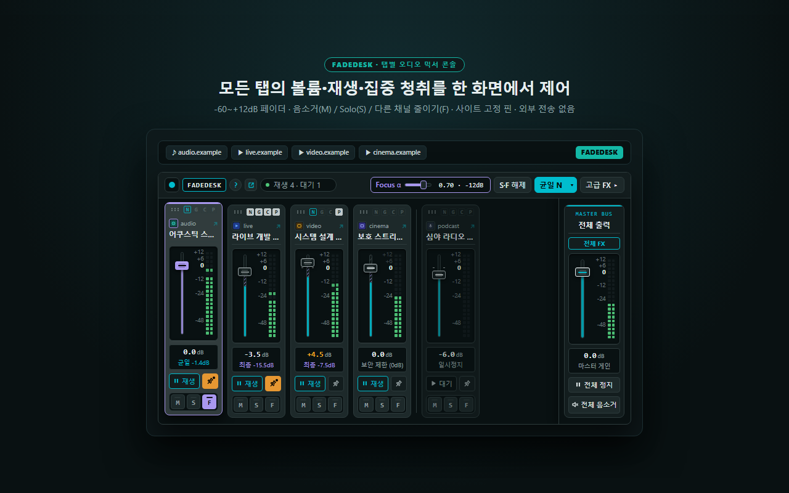
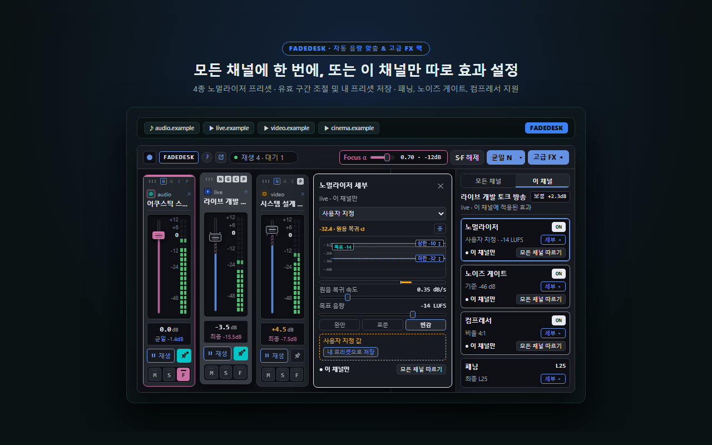
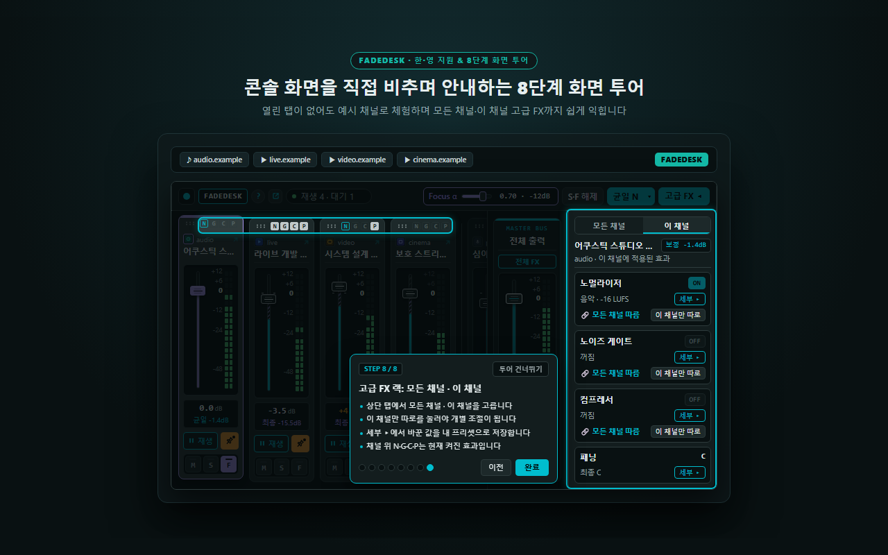
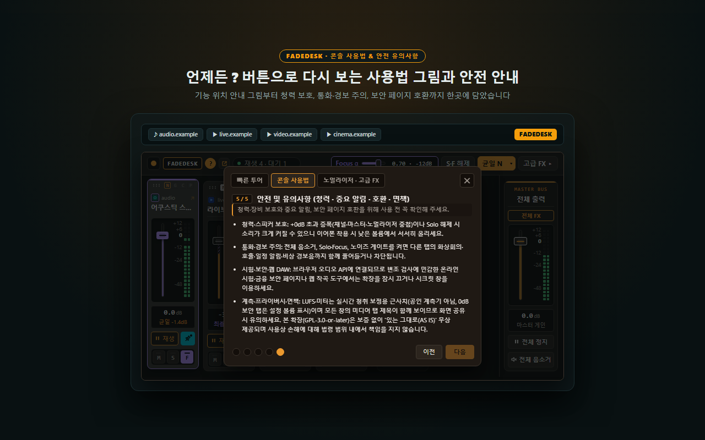

<div align="center">



# Fadedesk

**탭마다 제각각인 브라우저 소리, 한 화면의 페이더 데스크로 정리하세요.**

여러 창과 백그라운드 탭의 재생·볼륨(`-60 ~ +12 dB`)·집중 청취(`Focus`/`Solo`)·음량 평준화(`BS.1770 LUFS`)를<br/>
스튜디오 믹서 화면 하나로 모아 다루는 Chrome 오디오 콘솔 확장입니다.<br/>
화면 캡처 권한(`tabCapture`) 없이, 외부 서버 전송 없이 브라우저 안에서만 가볍게 동작합니다.

[**한국어**](README.md) · [English](README.en.md) · [**최신 릴리스 받기 (`v1.2.4` ZIP)**](https://github.com/Argoneon1810/Fadedesk/releases/latest) · [Chrome 웹 스토어](https://chromewebstore.google.com/detail/fadedesk/dfklknhlpfjhdijdaadgbliolpkkhhpi) · [바뀐 내역](CHANGELOG.md) · [개인정보처리방침](PRIVACY.md) · [버그 제보](https://github.com/Argoneon1810/Fadedesk/issues)

</div>

---



## 이럴 때 씁니다

- **회의나 강의를 들으면서 배경 음악만 잔잔하게 깔고 싶을 때** — 주력 탭에 **`F` (Focus)** 하나만 켜면 나머지 배경 탭 소리가 지정한 비율(`Focus α`)만큼 부드럽게 내려갑니다.
- **영상·방송마다 음량이 들쑥날쑥해 볼륨 키를 계속 만질 때** — 상단 **`균일 N ▾`** 버튼 하나로 방송 표준(`ITU-R BS.1770-4`)에 맞춰 작은 소리는 올리고 귀를 찌르는 급등은 눌러 줍니다.
- **열어 둔 탭 수십 개 중 어디서 소리가 나는지 찾기 번거로울 때** — 모든 창의 미디어 탭이 채널 스트립으로 한곳에 모입니다. 콘솔에서 바로 멈추거나 헤더(`↗`)를 눌러 그 탭으로 건너갑니다.
- **"탭 공유 중" 파란 배너나 전체화면 제약이 거슬릴 때** — 탭 오디오를 통째로 녹화 스트림으로 가로채는 `chrome.tabCapture` 방식을 쓰지 않아 상단 공유 배너가 뜨지 않고 영상 전체화면도 막히지 않습니다.

---

## 설치하기

### 1. 공식 릴리스 ZIP으로 바로 설치 (빌드 도구 불필요)

소스 코드를 직접 빌드하거나 `Node.js`를 설치할 필요 없이 바로 넣을 수 있습니다.

1. [GitHub Releases 페이지](https://github.com/Argoneon1810/Fadedesk/releases/latest)에서 최신 **`fadedesk-1.2.4.zip`**([직접 다운로드](https://github.com/Argoneon1810/Fadedesk/releases/download/v1.2.4/fadedesk-1.2.4.zip))을 내려받아 지우지 않을 폴더(예: `문서\Fadedesk`)에 압축을 풉니다.
2. Chrome 주소창에 `chrome://extensions`를 입력해 이동한 뒤 오른쪽 위 **개발자 모드(Developer mode)** 를 켭니다.
3. 왼쪽 위 **압축해제된 확장 프로그램을 로드합니다(Load unpacked)** 를 누르고 방금 압축을 푼 폴더(`manifest.json`이 바로 들어 있는 폴더)를 고릅니다.
4. 브라우저 우측 상단 퍼즐 아이콘에서 **Fadedesk**의 고정 핀을 켜 두면 언제든 바로 열 수 있습니다. 이미 열려 있던 미디어 탭도 새로고침 없이 즉시 연결됩니다.

### 2. Chrome 웹 스토어

- [Chrome 웹 스토어의 Fadedesk 페이지](https://chromewebstore.google.com/detail/fadedesk/dfklknhlpfjhdijdaadgbliolpkkhhpi)

<details>
<summary><strong>3. 소스 코드에서 직접 빌드해 넣기 (개발자용)</strong></summary>

`Node.js 18` 이상(`20+` 권장)이 필요합니다.

```bash
git clone https://github.com/Argoneon1810/Fadedesk.git
cd Fadedesk
npm install
npm run build
```

빌드가 끝나면 `dist/unpacked` 폴더가 생깁니다. `chrome://extensions`의 **압축해제된 확장 프로그램을 로드합니다**에서 저장소 루트가 아닌 **`dist/unpacked`** 폴더를 선택하세요.

</details>

---

## 콘솔 사용법

### 1. 탭별 `dB` 페이더와 구역 드래그 정렬 · 사이트 고정 핀

- **실수 방지 노브 드래그 (`-60 dB` ~ `+12 dB`)**: 트랙 빈 곳을 스쳐 소리가 갑자기 튀지 않도록 페이더 손잡이(노브)를 직접 잡고 움직입니다. 마우스 휠로 `1.5 dB`씩(`Shift + 휠`은 `0.5 dB`씩) 조절할 수 있고, 노브나 숫자 창을 두 번 누르면 기본값(`0.0 dB`)으로 돌아옵니다.
- **데시벨 직접 입력**: 페이더 아래 숫자 창을 눌러 `-12.5`처럼 원하는 값을 바로 적어 넣을 수 있습니다.
- **재생↔일시정지 구역 드래그와 탭 이동(`↗`)**: 스트립 맨 위 손잡이(`⠿`)를 끌어 순서를 바꾸거나, 가운데 구분선 너머로 옮겨 재생과 일시정지를 바로 오갑니다. 사이트 이름 영역(`↗`)을 누르면 그 소리가 나는 브라우저 창과 탭이 앞으로 나옵니다.
- **사이트 고정 핀(`📌`)**: 자주 가는 사이트의 시작 볼륨을 기억해 둡니다. 핀을 켜 두더라도 이미 열려 있는 같은 사이트의 여러 탭은 서로 묶이지 않고 채널마다 따로 움직입니다.

### 2. 집중 청취 — `Mute` · `Solo` · `Focus α`

각 채널 아래쪽 스위치 세 개로 여러 탭 사이의 청취 균형을 잡습니다.

| 스위치 | 동작 |
| --- | --- |
| **`M` (Mute)** | 해당 탭만 조용히 음소거합니다. 다시 누르면 원래 설정한 볼륨으로 돌아옵니다. |
| **`S` (Solo)** | 고른 탭만 남기고 나머지 모든 탭을 음소거합니다(`Shift+클릭`으로 복수 선택 가능). 유일하게 `Solo`가 켜진 탭을 닫더라도 나머지 탭 소리가 갑자기 폭발하지 않도록 `0.3초`에 걸쳐 부드럽게 복원됩니다. |
| **`F` (Focus)** | 이 채널은 원래 볼륨 그대로 또렷하게 두고, 다른 채널들만 상단 **`Focus α`**에서 정한 폭(비율 또는 데시벨 직접 입력)만큼 부드럽게 줄여 함께 듣습니다. |

### 3. 방송 표준 음량 평준화(`균일 N ▾`)와 고급 FX 랙(`모든 채널` · `이 채널`)



상단 **`균일 N ▾`** 버튼은 실시간 `ITU-R BS.1770-4` 라우드니스 계측과 `EBU Tech 3341` 시간 창을 바탕으로 탭마다 다른 음량을 자동으로 맞춰 줍니다(새로 설치 시 **음악** 프리셋으로 기본 켜짐).

- **유효 구간과 원음 복귀 속도**: 들어오는 소리 가운데 **유효 구간**(예: `-32 ~ -10 LUFS`) 안의 소리만 보고 볼륨을 맞춥니다. 구간을 벗어난 아주 여린 소리나 폭발적인 소리에서는 보정을 멈추고, **원음 복귀 속도**에 따라 원래 볼륨(`0.0dB`)으로 천천히 돌아갑니다.
- **`-10 LU` 상대 게이트**: 곡 중간의 조용한 정적·잔향 구간에서 볼륨이 멋대로 치솟았다가 다음 박자에 귀를 때리지 않도록 자동 증폭을 잡아 둡니다.

| 프리셋 | 목표 음량 · 시간 창 | 최대 증폭 | 어울리는 상황 |
| --- | --- | --- | --- |
| **클래식 (원음 · 광대역)** | `-16 LUFS` · `15s` 광대역 | `+4dB` | 아주 여린 독주나 폭발적인 연주에서는 원래 볼륨으로 돌아가 원곡의 넓은 강약을 살릴 때 |
| **음악 (강약 보존 · 기본)** | `-16 LUFS` · `9s` 완만 | `+6dB` | 한 곡 안의 잔잔한 구간과 후렴구의 강약 차이는 살리고 곡이 바뀔 때 음량 차이만 맞출 때 |
| **표준 (영상 · 방송)** | `-16 LUFS` · `3s` 표준 | `+7.5dB` | 유튜브·스트리밍·강의 탭을 오갈 때 들쭉날쭉한 목소리와 배경음 볼륨을 일정하게 맞출 때 |
| **야간 (강한 균일)** | `-18 LUFS` · `0.4s` 민감 | `+9dB` | 늦은 밤 갑작스러운 큰 소리는 빠르게 누르고 작은 대사는 또렷하게 유지할 때 |

오른쪽 **`고급 FX ▸`** 랙(또는 마스터 버스의 **`전체 FX`**)을 열면 상단 **`[모든 채널 | 이 채널]`** 탭으로 설정할 대상을 고를 수 있습니다. 현재 설정 중인 대상(개별 채널 또는 마스터 버스)은 배경이 밝게 강조되며, 각 채널 상단의 **`N` · `G` · `C` · `P` 배지**로 현재 켜진 효과를 한눈에 확인합니다.

- **`🔗 모든 채널 따름`과 `이 채널만 따로`**: 노멀라이저·노이즈 게이트·컴프레서 카드는 기본적으로 모든 채널 설정을 따라 잠겨 있습니다. 특정 채널만 다르게 설정하려면 **`이 채널만 따로`**를 눌러 잠금을 풀고, 언제든 **`모든 채널 따르기`**로 되돌릴 수 있습니다.
- **`세부 ▸` 창과 내 프리셋 저장**: 카드의 **`세부 ▸`**를 누르면 옆에 세부 창이 열려 프리셋, 유효 구간(실시간 스펙트럼 `↕` / 막대 `↔` 드래그 조절), 원음 복귀 속도, 목표 음량을 세밀하게 조절합니다. 직접 바꾼 노멀라이저 설정은 **`내 프리셋으로 저장`**(최대 20개, 이름 변경·삭제 지원)해 다른 채널이나 상단 **`균일 N ▾`** 목록에서 바로 골라 쓸 수 있습니다.
- **스테레오 패닝 (`Pan`) & `전체 밸런스`**: 여러 방송이나 강의를 동시에 들을 때 소리가 맺히는 좌우 위치(`L100 ~ C ~ R100`)를 나눠 귀에서 섞이지 않게 분리합니다. 모든 채널 설정의 **`전체 밸런스`**를 조절하면 채널 간 좌우 간격은 그대로 유지한 채 전체 중심만 옮길 수 있습니다.
- **노이즈 게이트 (`Gate`)**: 지정한 **차단 기준**(`-65 ~ -30 dB`)보다 작은 마이크 화이트노이즈와 잔잔한 배경 잡음을 깔끔하게 음소거합니다.
- **다이내믹 컴프레서 (`Comp`)**: `약(2:1)` · `중(4:1)` · `강(8:1)` 압축과 `-1.0 dBFS` 안전 피크 리미터로 갑작스럽게 튀는 비명이나 폭발음 피크를 매끄럽게 눌러 귀를 보호합니다.

### 4. 별도 콘솔 창(`↗`) · 4가지 테마 · 8단계 화면 투어와 기능 안내 그림

| 8단계 화면 투어 | 기능 위치 안내 그림 & 안전 안내 |
| :---: | :---: |
|  |  |

- **별도 콘솔 창 분리 (`↗`)**: 툴바 팝업을 크기 조절 가능한 별도 창(`최소 520×420` 자동 유지, 크기 기억)으로 떼어내 보조 모니터에 띄워 두고 쓸 수 있습니다.
- **4종 스튜디오 테마 & Focus 전용 배색**: 4가지 포인트 배색과 다크·라이트·시스템 모드를 조합할 수 있습니다. `Focus`를 켠 채널은 테마별 전용 색으로 표시되며, 페이더에서 실제로 줄어들거나 꺼진 몫은 이유에 따라 다른 색의 빗금(음소거 = 빨강, `Solo`로 꺼짐 = Solo 색, `Focus`로 줄어듦 = Focus 색)으로 한눈에 보여 줍니다.
- **8단계 화면 투어 & 기능 안내 (`?`)**: 처음 쓰는 분도 바로 익힐 수 있도록 실제 콘솔 화면과 고급 FX 랙을 차례로 비추며 짧은 카드로 안내하는 **8단계 화면 투어**(열린 미디어 탭이 없어도 예시 채널 2개로 체험 가능)와 기능별 위치 안내 그림을 내장했습니다. Chrome 언어 설정에 따라 **한국어**와 **영어**로 자동 전환됩니다.

---

## 키보드 단축키

전역 단축키는 `chrome://extensions/shortcuts`에서 원하는 키 조합으로 바꿀 수 있습니다.

| 범위 | Windows / Linux | macOS | 동작 |
| --- | --- | --- | --- |
| 전역 | `Alt + Shift + M` | `Control + Shift + M` | Fadedesk 콘솔 열기 |
| 전역 | `Alt + Shift + 0` | `Control + Shift + 0` | 전체 마스터 음소거 켜기 / 끄기 |
| 전역 | `Alt + Shift + F` | `Control + Shift + F` | 재생 중인 미디어 탭 순서대로 `Focus` 옮기기 |
| 콘솔 안 | `←` / `→` | `←` / `→` | 이전 / 다음 채널 스트립 고르기 |
| 콘솔 안 | `↑` / `↓` (`Shift` 미세) | `↑` / `↓` (`Shift` 미세) | 선택 채널 볼륨 `±1.5 dB` (`±0.5 dB`) 조절 |
| 콘솔 안 | `0` / `Space` / `Enter` | `0` / `Space` / `Enter` | `0.0 dB` 복귀 / 재생·일시정지 / 해당 탭으로 이동 |
| 콘솔 안 | `M` / `S` / `F` / `P` | `M` / `S` / `F` / `P` | 음소거 / Solo / Focus / 사이트 고정 핀 켜기·끄기 |

---

## 알아 둘 점과 안전 안내

- **암호화(DRM)·교차 출처 미디어 자동 호환 (`0 dB` 상한)**: 넷플릭스 같은 DRM 보호 영상이나 CORS 보안이 걸린 외부 스트림은 브라우저 보안 정책상 WebAudio 파형 가공을 붙이면 소리가 끊깁니다. Fadedesk는 이런 미디어를 감지해 소리 끊김 없이 브라우저 기본 볼륨 제어(`-60 ~ 0 dB`)로 자동 전환합니다.
- **로컬 미디어 파일 (`file://`) 제어**: PC에 저장된 오디오·영상 파일을 Chrome으로 열어 조절하려면 `chrome://extensions` → Fadedesk **세부정보**에서 **파일 URL에 대한 액세스 허용**을 켜 주세요.
- **청력 및 스피커 보호 주의**: `+0 dB` 위로 채널·마스터·노멀라이저 증폭을 겹쳐 올리거나 `Solo`를 해제할 때 소리가 크게 커질 수 있습니다. 이어폰·헤드폰 착용 시에는 낮은 볼륨에서 서서히 올려 쓰세요.
- **통화·경보 주의 및 보안 페이지 호환**: 전체 음소거, `Solo`·`Focus`, 노이즈 게이트를 켜면 다른 탭에 열린 화상회의·호출·일정 알림·비상 경보음까지 함께 줄어들거나 차단됩니다. 또한 브라우저 오디오 API에 연결되므로 스크립트 검사가 엄격한 온라인 감독 시험·금융 보안 페이지·웹 DAW 작업 중에는 확장을 잠시 끄거나 시크릿 창을 이용하세요.
- **실시간 근사 계측 및 화면 공유 주의**: 화면에 표시되는 `LUFS`와 레벨 미터는 실시간 청취 보정용 근사치이며 방송 납품 검수용 공인 계측기가 아닙니다. 열린 모든 창의 미디어 탭 제목이 콘솔에 함께 나타나므로 화면 공유 전에 확인하세요.

---

## 개인정보 보호와 권한 안내

Fadedesk는 **아무것도 수집하지 않고 기기 밖으로 아무것도 보내지 않습니다.** 확장 페이지에는 `connect-src 'none'` 보안 정책이 걸려 있어 외부 통신 자체가 차단되어 있으며, 모든 설정은 브라우저 로컬 저장소에만 남습니다. 자세한 내용은 [개인정보처리방침 (`PRIVACY.md`)](PRIVACY.md)에 적혀 있습니다.

| 권한 | 쓰는 이유 |
| --- | --- |
| `tabs` | 여러 창에 열린 오디오·동영상 탭의 제목·파비콘·도메인을 채널 스트립에 보여 주고, 헤더(`↗`)를 눌렀을 때 해당 탭으로 포커스를 옮기며, 사이트 고정 핀 기본 볼륨을 대조합니다. |
| `storage` | 설정한 볼륨, 테마, 독립 창 크기, 사이트 고정 핀 목록을 브라우저 내부(`chrome.storage.local` / `session`)에만 저장합니다. |
| `scripting` | 확장을 설치하거나 업데이트하기 전부터 이미 열려 있던 미디어 탭에도 새로고침 없이 즉시 볼륨 제어기를 연결합니다. |
| `<all_urls>` | 웹 동영상과 오디오는 특정 사이트 하나에만 있지 않으므로, 사용자가 소리를 재생하는 모든 탭에서 실시간 볼륨·패닝·음량 평준화를 수행하기 위해 필요합니다. |

---

## 개발 및 검증 명령어

소스는 외부 런타임 라이브러리 없이 순수 TypeScript(`src/`)와 Web Audio API로 작성되어 있으며, 빌드 스크립트([scripts/build.mjs](scripts/build.mjs))가 화이트리스트에 등록된 17개 런타임 파일만 `dist/unpacked/`와 `dist/fadedesk-<version>.zip`으로 묶어 냅니다. 확장을 다시 빌드해 새로고침해도 이미 재생 중인 탭의 오디오 그래프가 끊기지 않고 교체되는 무중단 핫스왑(`Hot-Swap`)을 지원합니다.

```bash
npm test             # 전체 검증: 타입 검사 + 단위·핫스왑 테스트(43건) + 빌드 + 한·영 헤드리스 UI 감사(26건)
npm run typecheck    # TypeScript 정적 타입 검사 (tsc --noEmit)
npm run test:unit    # dB/LUFS 수학, 상태 저장소, DOM 오디오 훅, 무중단 핫스왑 테스트
npm run build        # dist/unpacked 및 dist/fadedesk-<version>.zip 생성
npm run test:ui      # 실제 Chrome 헤드리스 렌더링 기반 한·영 레이아웃 넘침·상호작용 감사
```

---

## 문서 및 라이선스

- **라이선스**: [GNU General Public License v3.0 or later (`GPL-3.0-or-later`)](LICENSE) — 보증 없이 있는 그대로(`AS IS`) 무상 제공됩니다.
- **외부 오픈소스 고지**: [THIRD_PARTY_NOTICES.md](THIRD_PARTY_NOTICES.md) (배포 번들 내 제3자 런타임 라이브러리 `0건`)
- **개인정보처리방침**: [PRIVACY.md](PRIVACY.md)
- **판별 바뀐 내역**: [CHANGELOG.md](CHANGELOG.md)
